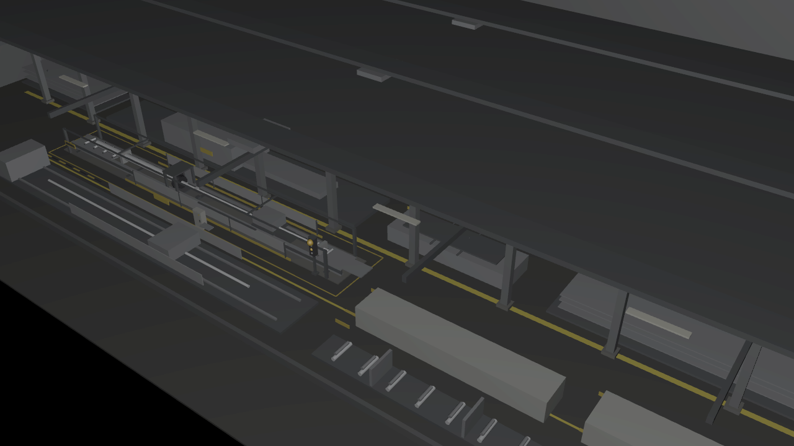
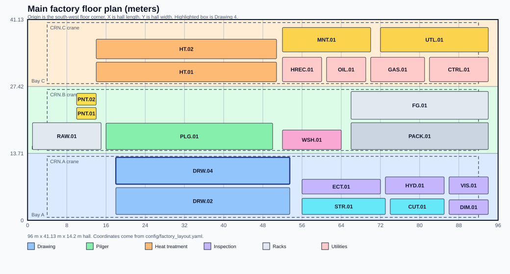
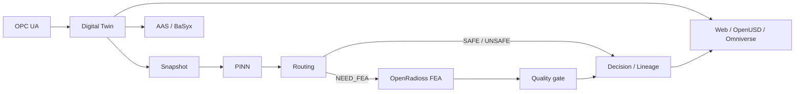
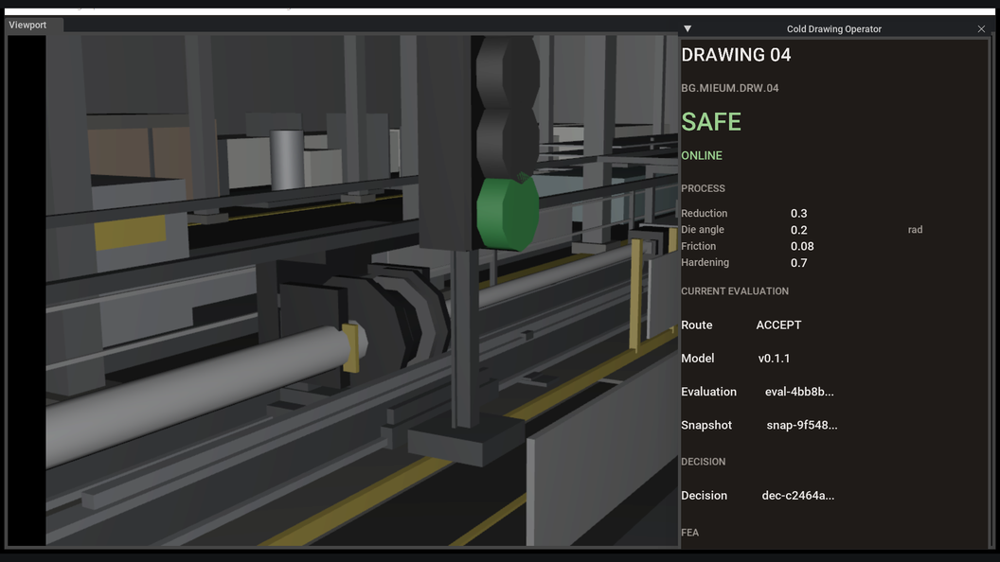

# ColdDrawingDT

A digital twin connecting machine state and analysis results for cold drawing. State collected through OPC UA is captured in immutable Snapshots. Fast PINN predictions and selective OpenRadioss FEA results are stored as Decisions with lineage. OpenUSD/Omniverse and the web interface display the same backend state.

## Digital Twin



The factory layout and Drawing 4 asset are modeled in OpenUSD.



## Data Flow





Snapshot, Evaluation, and Decision IDs trace inputs through to results. When FEA decision thresholds have not been validated for the mill, results require review rather than an automatic SAFE/UNSAFE verdict.

## Run

Requires Python 3.12 or later.

```bash
python3 -m venv .venv
source .venv/bin/activate
pip install -e ".[dev]"
make fetch-pinn
make test
make factory-stage
make seed-opcua
make demo-fast
make api
```

Web operator interface: http://127.0.0.1:8000/operator

AAS Inspector: http://127.0.0.1:8000/aas-inspector

To start development services, including PostgreSQL and BaSyx:

```bash
cp .env.example .env
docker compose up -d
```

FEA execution requires OpenRadioss binaries. See the [FEA guide](docs/openradioss-fea.md) for installation and validation.

## Repository Layout

| Path | Contents |
|---|---|
| `src/cold_drawing_twin/` | Twin, Snapshot, analysis routing, API, persistence |
| `simulation/`, `workers/` | FEA templates and job execution |
| `usd/`, `omniverse/` | 3D machine assets and display applications |
| `schemas/`, `config/` | Data contracts and machine configuration |
| `tests/`, `docs/` | Tests and technical documentation |

LLM and vision components are maintained in separate repositories: [ColdDrawingAgent](../ColdDrawingAgent/README.md), [ColdDrawingVision](../ColdDrawingVision/README.md).

[Architecture](docs/architecture.md) · [Digital Twin](docs/digital-twin.md) · [Demo](docs/live-demo.md) · [Documentation](docs/README.md)
