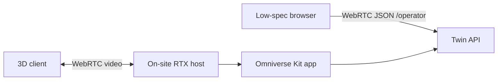

# OpenUSD and Omniverse

Terms: [glossary](glossary.md).

OpenUSD is the spatial source of truth. Omniverse Kit is the 3D app. Neither owns safety rules or process measurements.

This version generates a **conceptual OpenUSD representation of the manufacturing line, driven by real backend state**. It is not mill CAD, not OEM geometry, and not an as-built plant model. Kit apps call the HTTP API. Operator browsers can open `/operator` for a WebRTC datachannel (Twin state JSON, not a rendered 3D frame). Kit livestream (`omni.kit.livestream.webrtc`) still needs the site RTX Kit binary, the same way OpenRadioss needs solver binaries.

## Root tree

```text
/World
  BugokFactory
    Facility          (floor, aisles, columns, lights, cameras)
    Production
      Drawing
      Pilger
      HeatTreatment
      Pointing
      Cleaning
      Straightening
      Cutting
      Packaging
    Inspection
      ECT
      Hydro
      Dimension
      Visual
    MaterialHandling
      Racks
      Cranes
    Utilities
```

Drawing 4 prim: `/World/BugokFactory/Production/Drawing/Drawing_04` references `usd/assets/drawing/Drawing_04.usda`. That file is a conceptual cold-drawing line (frame, die housing, input/output workpiece, pulling section, guarding, cabinet, status tower). `StatusIndicator/proxy` and `StatusIndicator/render` remain the bind targets. The live bind also tints `StatusTower` lamp prims. Stage cameras live under `/World/Cameras`: `FactoryOverview`, `DrawingLine`, `Drawing04Hero`, `Drawing04Process`, `StatusDetail` (legacy `CAM_*` names remain as aliases).

Kit extensions poll `GET /assets/{id}/live` on a timer. They map Asset ID to `usd_prim` from [config/asset_registry.yaml](../config/asset_registry.yaml). They display backend verdicts; they do not compute safety. Fetch failure sets `Backend: OFFLINE` and a gray indicator. It does not become `ANALYSIS_REQUIRED`.

The operator and senior extensions each open one compact `omni.ui` faceplate:

- Header: DRAWING 04, Asset ID, verdict or WAITING FOR FEA, Backend ONLINE/OFFLINE (once)
- Process: reduction, die angle, friction, quality, source time
- Current Evaluation: route, model, Evaluation ID, Snapshot ID
- Decision: Decision ID. When FEA is running, last finalized verdict is a secondary line
- FEA: `NOT REQUIRED` on a fast-path ACCEPT; `RUNNING` while a job is active; `COMPLETED` after an INCONCLUSIVE FEA. Historical `last_completed` jobs stay under History and are not the current FEA block

Missing fields render as a dash. The extension writes `displayColor` and `coldDrawing:*` attributes onto `Drawing_04` and `Drawing_04/StatusIndicator`. The 3D lamp still uses the existing verdict colors (`SAFE` green, `UNSAFE` red, `ANALYSIS_REQUIRED` blue, `INCONCLUSIVE` / `MANUAL_REVIEW` amber). While FEA is running, the live panel shows `WAITING FOR FEA` and `Engineering decision pending.`; the last finalized Decision stays on a secondary line. An `INCONCLUSIVE` Decision is presented as `MANUAL REVIEW` with the engineering verdict shown separately. Chrome does not invent a verdict. Default CI does not launch Kit; mapping tests run without it. The live sequence is [live-demo.md](live-demo.md).

## Asset files

Each important Asset is its own USD file.

```text
usd/factory/bugok_factory.usda
usd/assets/drawing/Drawing_04.usda
usd/assets/{pointing,pilger,heat_treatment,cleaning,straightening,cutting,packaging,...}
usd/materials/industrial_materials.usda
usd/cameras/stage_cameras.usda
```

Drawing 4 is a conceptual cold-drawing line (frame, die housing, input/output workpiece, pulling section, guarding, cabinet, status tower). Other process assets are distinct low-poly silhouettes, not repeated slabs. `StatusIndicator/proxy` and `StatusIndicator/render` remain the bind targets. Stage cameras live under `/World/Cameras`: `FactoryOverview`, `DrawingLine`, `Drawing04Hero`, `Drawing04Process`, `StatusDetail`.

Use:

- `payload` for large optional assets
- `proxy` purpose for distant areas
- `render` purpose for the focused machine
- variants for equipment state when useful

## Senior app (this version)

- Whole-factory stage (`usd/factory/bugok_factory.usda`)
- Same live panel and StatusIndicator bind as the operator extension, default Asset `BG.MIEUM.DRW.04`
- HTTP evaluate helper `POST /assets/{id}/evaluations`

Not in this version: Snapshot timeline UI, FEA contour overlay, status filters, Scenario compare UI.

## Operator app (this version)

- Assigned line `BG.MIEUM.DRW.04`
- `omni.ui` live faceplate (attention banner, process variables, lineage, FEA)
- Backend verdict colors on the 3D StatusIndicator: `SAFE` green, `UNSAFE` red, `ANALYSIS_REQUIRED` blue, `INCONCLUSIVE` / `MANUAL_REVIEW` amber
- Unknown verdict or backend OFFLINE: gray, text `Backend OFFLINE. State unavailable.`
- FEA lifecycle from backend job status only

Do not show a second decision engine. Browser `/operator` is Twin JSON over WebRTC or HTTP poll, not a 3D frame.

## Low-spec delivery

RTX render stays on an on-site GPU host. The operator browser can use `/operator` (Twin JSON over a WebRTC datachannel) without Kit. 3D livestream still uses Kit on that host.



The operator client must not query the Digital Twin database directly. Domain data reaches Kit and `/operator` through the app API.

## Twin to 3D map

[config/asset_registry.yaml](../config/asset_registry.yaml) maps:

```text
Asset ID <-> AAS ID <-> OpenUSD prim
```

State changes may update badges, material position, activity, alerts, and FEA overlays. They must not write process values into USD as authority.

## FEA view

Keep with each job:

- `job_id`
- `snapshot_id`
- solver version
- mesh or deformed geometry
- field values and critical-region metadata

UI may show:

1. Undeformed reference
2. Deformed result
3. Selected stress or strain field
4. Critical-region marker
5. Before and after

Demo FEA job ID in docs: `fea-0001`.

## Streaming acceptance

- `/operator` serves a display-only page; Twin state rides a WebRTC datachannel with HTTP poll fallback
- Streamable Kit app runs on the RTX host when Kit is installed
- Chromium can open `/operator` without Kit
- Kit 3D keyboard and mouse round-trip is a host Kit concern
- Streaming failure never changes a stored Decision
